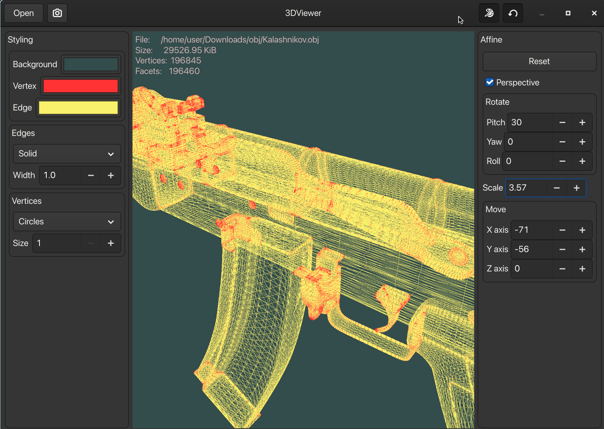
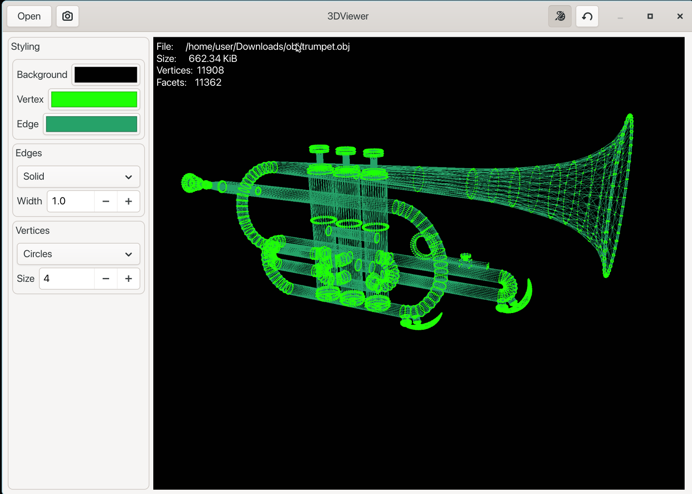

# ecole-3DViewer_v2
A simple GTK4 3D model viewer. WiP.

## Implemented features:
 - loading model mesh from Waveform .obj file
 - making 5 second GIF screencasts of the model
 - config with autosave for styling settings persistence
 - translating and scaling the model
 - orthographic / perspective projection toggle
 
## Screenshots

## Building on Linux
First you need to install dependencies:
 - a C++20 compiler toolchain (tested with gcc and clang)
 - cmake 
 - pkgconf
 - gtkmm-4.0 
 - doxygen
      
To build and run the app just run:
    ` ./build.sh `

for additional build options:
    ` ./build.sh --help `

## Usage
By default config is saved in $XDG_CONFIG_HOME/3DViewer.ini but config location can be overriden with -c/--config flag for example:
    `./3DViewer --config /home/user/Documents/myconfig.ini `

